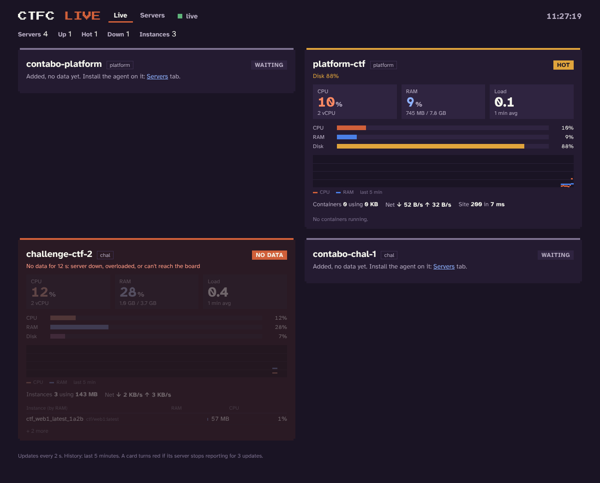

# ctfc-monitor

Monitoring for the CTFC club's CTF events: alerts, a dashboard with history, and a live board.
Event servers (platform, challenge servers, backups, failover) are in **[ctf-infra](https://github.com/nit-bt/ctf-infra)**.



| Part | Runs on | What it does | Setup |
|---|---|---|---|
| **ctf-alert** (`alerts/`) | every platform / challenge server | checks every minute (Docker, RAM, disk, firewall, CTFd containers, peers) → Discord / Telegram, live status card | [docs/alerts.md](docs/alerts.md) |
| **Uptime Kuma** | monitor VM (`ctf-monitor`, GCP e2-micro) | history, uptime %, alerts when a server or the site dies, status page | [docs/monitoring.md](docs/monitoring.md) |
| **Live board** (`live/`) | board on the monitor VM, agent on every server | every 2 s: CPU, RAM, disk, load, every instance's usage; add/remove VMs from the page; login page | [docs/monitoring.md](docs/monitoring.md#4d-live-board-every-2-s-custom-page) |
| **HTTPS** (`https/`) | monitor VM | https://kuma.ctfc.live and https://live.ctfc.live via Caddy + Cloudflare | [docs/https.md](docs/https.md) |

## Where things live on the servers

| Path | What |
|---|---|
| `/opt/ctfc-monitor` | this repo (monitor VM and every event server) |
| `/opt/ctf/ctf-infra` | the event repo (platform, challenge servers) |
| `/etc/default/ctf-alert` | alert settings (Discord webhooks, Kuma push URL, peers) |
| `/etc/default/ctf-live` | live agent settings (board URL, token, name) |
| `/etc/default/ctf-live-board` | board settings on the monitor VM (token, password hash) |

## New event server, all three in one go

```bash
sudo git clone https://github.com/nit-bt/ctfc-monitor.git /opt/ctfc-monitor 2>/dev/null || sudo git -C /opt/ctfc-monitor pull
cd /opt/ctfc-monitor
sudo ./alerts/install-alerts.sh chal            # or: platform  → fill /etc/default/ctf-alert
sudo ./live/install-agent.sh chal               # or use the board's Servers tab → Add VM (gives a ready command)
```
Then in Kuma: add a Push monitor for it and put its URL in `/etc/default/ctf-alert` (`KUMA_PUSH_URL`).

## Updating

```bash
cd /opt/ctfc-monitor && sudo git pull
sudo ./alerts/install-alerts.sh chal     # re-run what's installed on that server; settings are kept
sudo ./live/install-agent.sh chal
sudo ./live/install-board.sh             # monitor VM only
```
